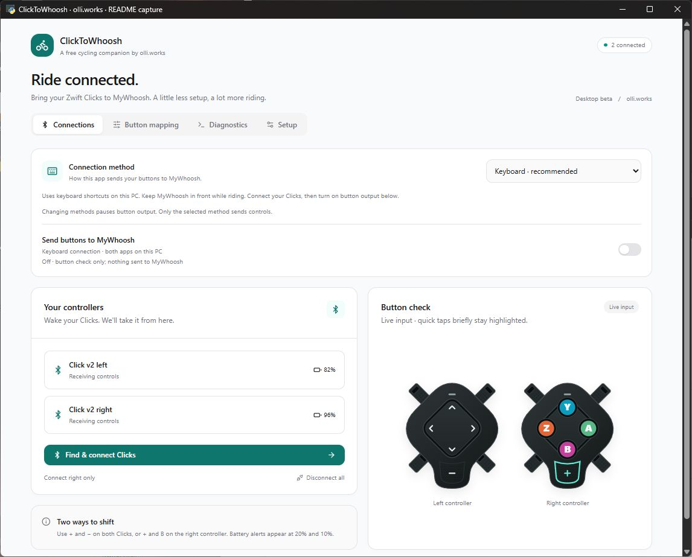
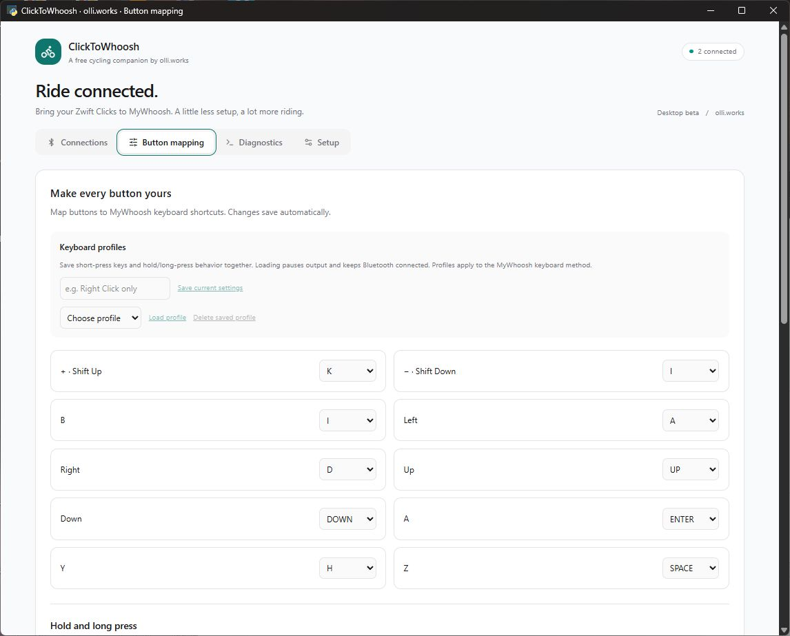
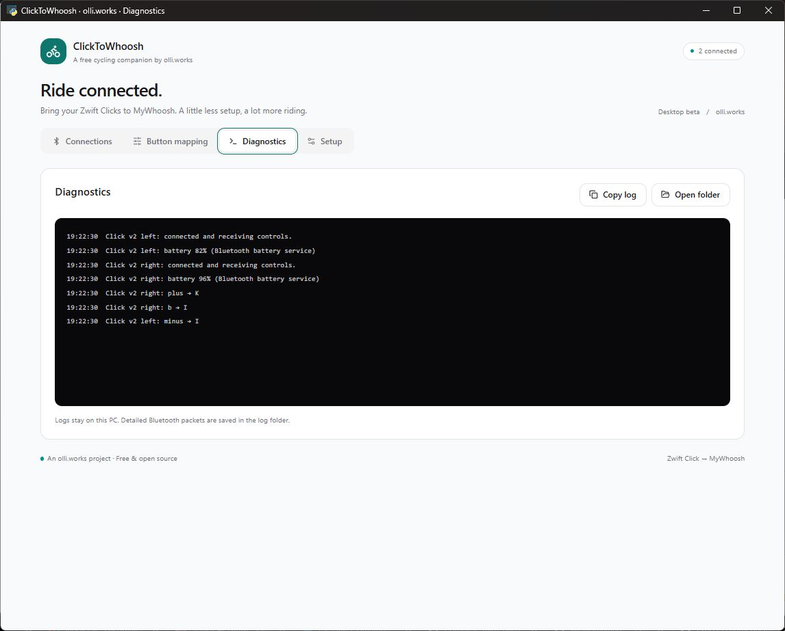

# 🚴 ClickToWhoosh

**Shift gears in MyWhoosh with your Zwift Click controllers.** Free and open source, by [olli.works](https://olli.works).

  

<a href="https://github.com/OlliGranlund/click2whoosh/releases/download/preview/ClickToWhoosh.exe"><strong>Download preview for Windows x64</strong></a> · <a href="https://github.com/OlliGranlund/click2whoosh/releases">Versioned releases</a>

*Connections view with sample controller data.*

One codebase, shared app versions. **Preview** tracks the newest successful build; **v2.0.0-beta.1** is a fixed milestone. Windows x64 describes the available download, not a separate app version.

**Beta · Windows 11 tested · Unsigned executable:** Windows may show an unknown-publisher or SmartScreen warning. No Python installation is needed. macOS/Linux downloads are not available.

## Get riding

You need Bluetooth Low Energy, Zwift Click controllers, and a compatible trainer paired in MyWhoosh with **MyShift / virtual gear shifting enabled**. The app uses WebView2 and .NET Framework 4.8, normally present on Windows 11.

1. Download and open **ClickToWhoosh.exe**.
2. Close other apps connected to your Clicks, wake the controllers, and select **Find & connect Clicks**.
3. Select **Keyboard** as the connection method. Check that button presses appear in the app.
4. In a MyWhoosh ride, confirm keyboard **K / I** changes gears. Enable **Send buttons to MyWhoosh** and keep MyWhoosh in front.

| Button | Action |
| --- | --- |
| Right **+** | Shift up |
| Right **B** or left **−** | Shift down |

Change assignments in **Button mapping**. Battery alerts, a visual button check and **Diagnostics** are available in the app.

**Button mapping** also supports saved keyboard profiles, held keys for steering, and a separate long-press key. **Setup** offers optional background discovery, MyWhoosh focus/launch, and experimental Zwift sign-in to unlock the left Click. See the [feature guide](docs/CONTROLLER_FEATURES.md).

## Before you ride

- **Start with right + / B.** Both shift directions have been ride-tested with Click v2 firmware 1.0.1.
- **Left Click v2:** may need unlocking through Zwift. Experimental restart recovery is off by default, causes input gaps, and has an unmeasured battery impact. Reported battery percentages can fluctuate.
- **Network mode:** experimental; MyWhoosh pairing and shifting remain unverified after a Windows discovery fix. Use Keyboard for riding.

[Troubleshooting and controls](docs/TECHNICAL_NOTES.md) · [Report a bug](https://github.com/OlliGranlund/click2whoosh/issues) · [Build from source](docs/DEVELOPMENT.md) · [Platform support](docs/PLATFORMS.md)

## Screenshots

The app is shown with sample controller data.

### Button mapping

### Diagnostics

## Why this app?

[BikeControl](https://github.com/OpenBikeControl/bikecontrol) inspired this project and may be a better fit if you want a broader controller companion. For my own use—simply shifting gears in MyWhoosh—ClickToWhoosh has been more than sufficient. This project shares that focused setup for free.

Read more about how the project came together in the [ClickToWhoosh blog post](https://olli.works/blog/click2whoosh/).

## Credits and license

An **[olli.works](https://olli.works)** project by Oliver Granlund, licensed under [MIT](LICENSE). See [acknowledgments](THIRD_PARTY_NOTICES.md) for protocol references and dependency licenses.

Independent project; not affiliated with or endorsed by Zwift, MyWhoosh or BikeControl.
